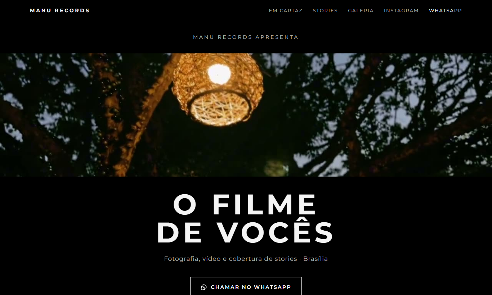
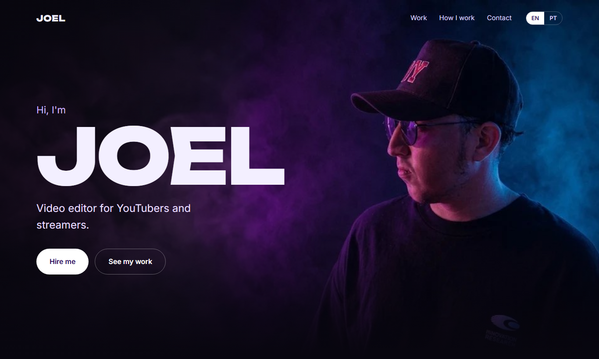

# Client websites — from zero to live in days

> 🇧🇷 **Resumo:** quatro sites que fiz com IA (Claude Code) para pessoas reais: uma psicóloga, uma fotógrafa, um editor de vídeo e uma pamonharia. Cada um foi do primeiro contato ao site no ar em poucos dias, publicado de graça no Cloudflare.

| Client | What they needed | Status |
|---|---|---|
| [Genna — psychologist](genna-psicologa/) | Replace a WordPress free site (with ads) with a clean, professional page that brings patients to WhatsApp | ✅ Live: https://psigenna.awx22.workers.dev/ |
| [Manu Records — photographer](manu-fotografia/) | A "cinema" style portfolio for photo, video and Instagram stories coverage | ✅ Done |
| [Joel — video editor](joel-editor-de-video/) | One page (in English) for YouTubers and streamers, with his videos and shorts playing inside the site | ✅ Live: https://joeleditor.awx22.workers.dev/ |
| [Pamonhas do Jonaci — corn cakes shop](pamonhas-do-jonaci/) | A menu and WhatsApp orders for a small neighbourhood business | 🟡 Ready to publish |

| | |
|---|---|
|  |  |
|  |  |

## How I work with each client

1. **Listen first:** what the business sells, who the customers are, and what action matters most (almost always: "send a WhatsApp message").
2. **Choose a style together:** instead of guessing, I build a page with 3–4 different styles side by side and the client picks one. See [`processo/`](processo/).
3. **Versions, never overwrites:** each round of feedback becomes a new folder (`v1`, `v2`, …) and the previous one stays intact, so we can always go back.
4. **Check on real devices:** desktop and phone, no horizontal scroll, text that fits.
5. **Publish for free:** a single static page (HTML + CSS, no database) on Cloudflare Workers, with social preview images, `robots.txt` and `sitemap.xml`.

## Using AI beyond code

For the corn cakes shop, the client's own photos were too small and dark. I wrote a **prompt kit for Gemini** to generate product images in a consistent style: same table, same light, one conversation per set. See [`processo/pamonhas-do-jonaci/prompts-de-imagem/`](processo/pamonhas-do-jonaci/prompts-de-imagem/).

## Timeline

| Site | Built |
|---|---|
| Genna | 28 Oct → live 29 Oct 2026 |
| Manu | 29 Oct → 4 Nov 2026 |
| Joel | 9 Nov 2026 |
| Pamonharia | 11 Nov 2026 |

## Run locally

Each folder is a static site. Open `index.html`, or:

```bash
python -m http.server 8000
```

## Notes

Texts, photos and videos belong to each client.

Shown here with their permission.
